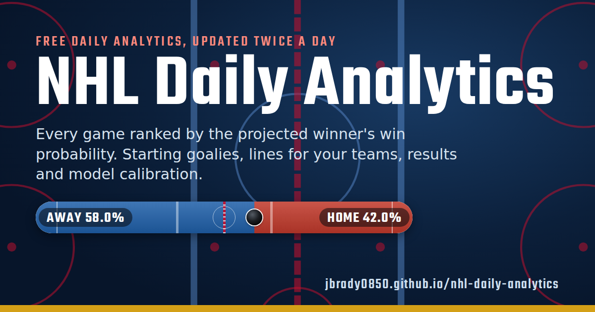
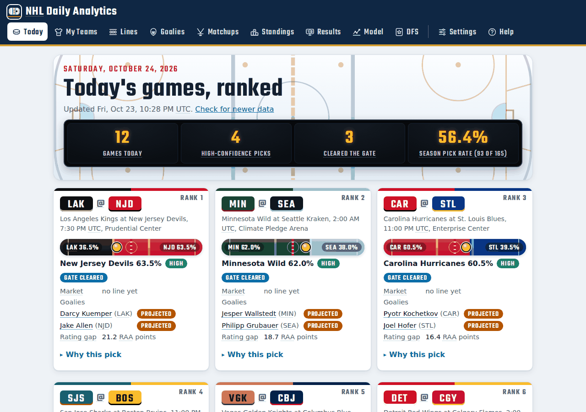
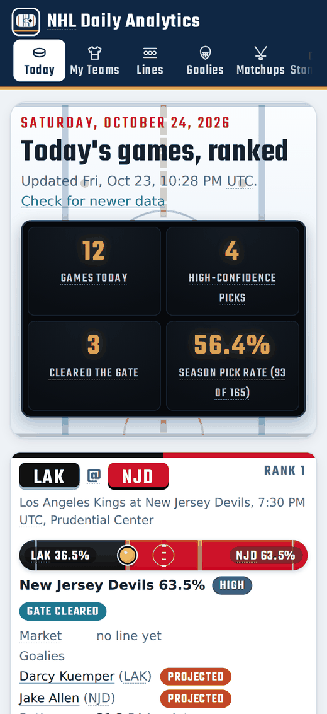
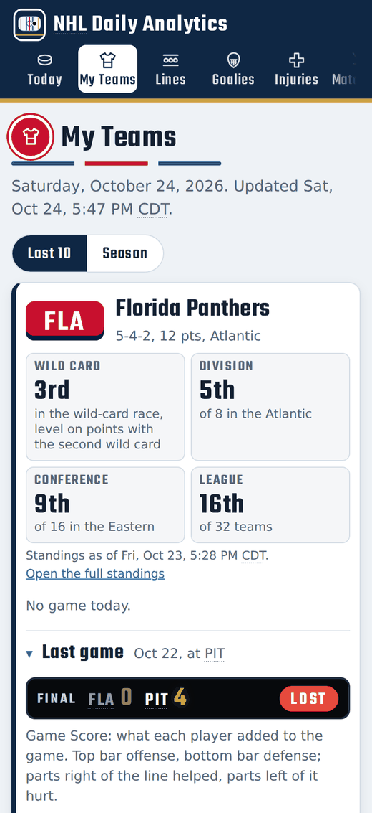
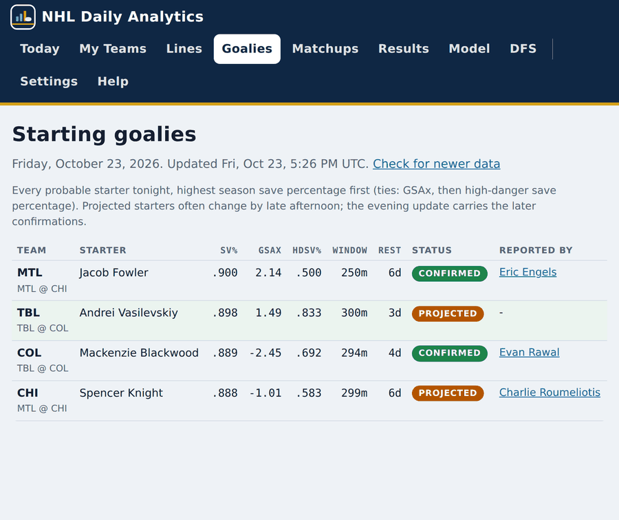
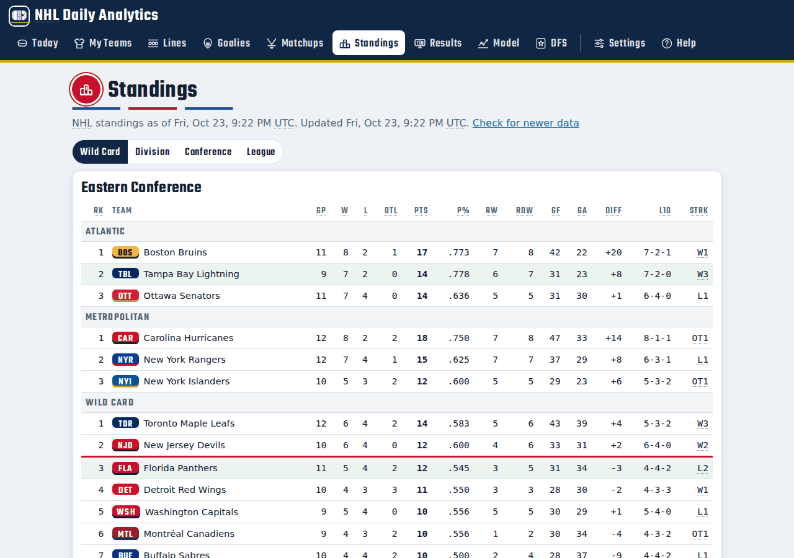
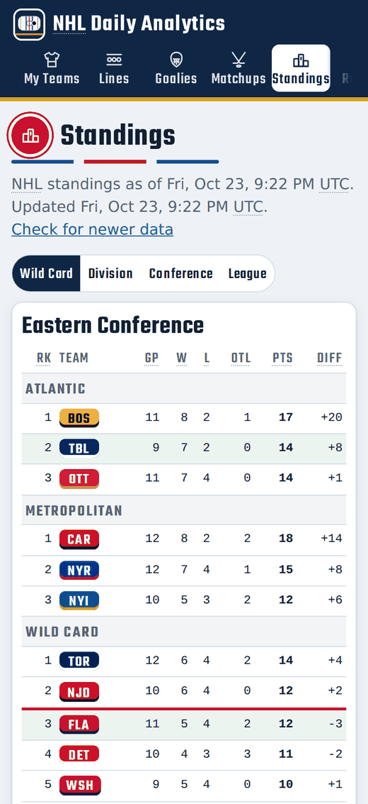
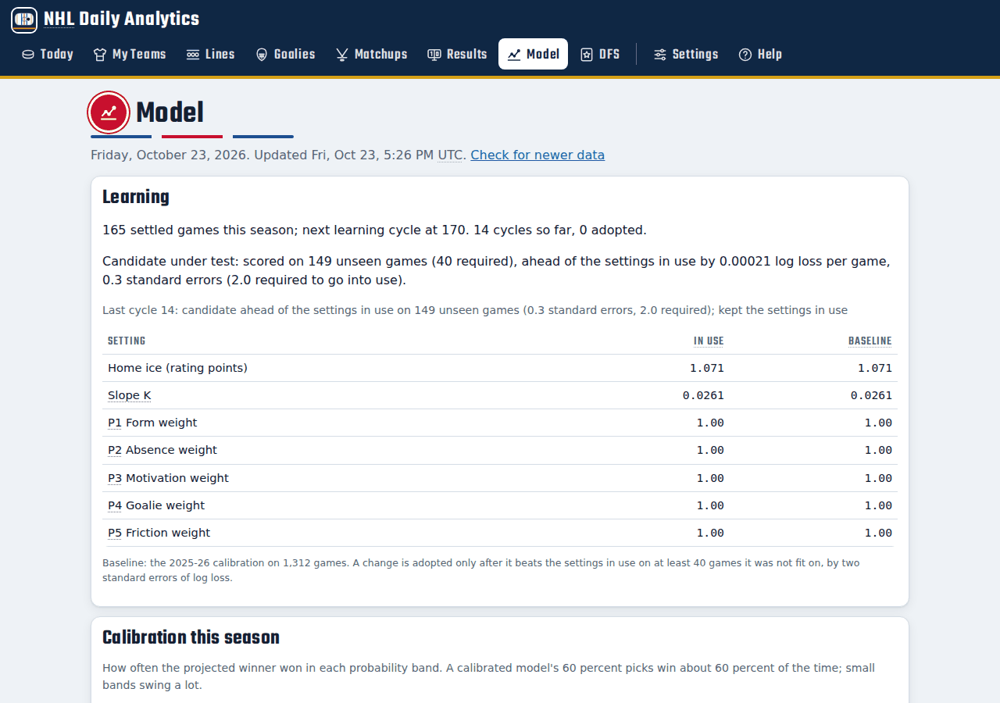

# NHL Daily Analytics



A free web app that ranks every NHL game of the day by the projected winner's win
probability. It also shows the starting goalies, the forward lines and defense pairs
for the teams you follow, the league standings, how the picks have done this season,
how well the model is calibrated, and daily fantasy (DFS) projections.

The data updates twice a day on GitHub's free servers from free public sources. There
is no account, no sign-in, no API key, no ads and no tracking. The app is plain HTML,
CSS and JavaScript, so it also opens straight from a downloaded copy.

Predictions are estimates for information and entertainment. This project is not
affiliated with or endorsed by the NHL or any team.

## Open the app

**https://jbrady0850.github.io/nhl-daily-analytics/**


Scan the code with a phone or tablet camera to open the app.

### Add it to your home screen

- **iPhone or iPad (Safari):** open the link, tap the Share button, then **Add to Home Screen**.
- **Android (Chrome):** open the link, tap the three-dot menu, then **Install app** or **Add to Home screen**.
- **Windows or Mac (Chrome or Edge):** open the link and click the install icon at the right end of the address bar.

The app then opens full screen like any other app. The Settings tab repeats these steps.

## Pick your teams

Open **My Teams** and tap any of the 32 teams. Each team you follow shows its record,
its place in the standings (wild-card race, division, conference and league), today's
game (if it plays), and its four forward lines and three defense pairs with
each player's numbers over his last 10 games or the whole season. Your games are also
marked on the Today and Goalies tabs.

Your picks stay in your own browser on your own device. Nothing is sent anywhere. To
start over, use **Clear** under the team list or **Clear my settings** in Settings.

## See what any term means

Hover over any colored tag, scoreboard number, column heading or dotted-underlined
abbreviation to see what it means. On a phone or tablet, tap it; tap anywhere else to
close it. With a keyboard, press Tab to reach it. Team abbreviations show the full team
name, and times show your device's time zone. The Help tab lists every term.

## Open a player's official page

Click or tap any player's name, in the lines tables, the goalie list, the game cards,
the missing-player lists or the DFS board, to open his official NHL.com page with his
bio and full stats. On a computer it opens in a separate window, and each name you
click after that loads in the same window. On a phone or tablet it opens in a new tab.
Names with a solid underline are links; a dotted underline marks a definition.

## Screenshots

| Today on a computer | Today on a phone |
| --- | --- |
|  |  |

| My Teams on a phone | Starting goalies on a tablet |
| --- | --- |
|  |  |

| Standings on a computer | Standings on a phone |
| --- | --- |
|  |  |



The screenshots use the sample data file in `tests/fixtures`.

## Run it from a download

1. On the project page, click **Code**, then **Download ZIP**, and unzip it.
2. Open the `app` folder and double-click `index.html`.

The downloaded copy shows the data from the day you downloaded it. The online app
always has the latest data.

## What each tab shows

| Tab | What you see |
| --- | --- |
| **Today** | Every game ranked by the projected winner's win probability, with the confidence tier (HIGH, MODERATE, LOW), the market's view for comparison, both starting goalies, and a "Why this pick" breakdown. |
| **My Teams** | The teams you follow: record, place in the wild-card race, division, conference and league, today's game, all four lines and three pairs with last-10 or season stats, and which line leads the team in points, shots and penalty minutes. |
| **Lines** | The four forward lines and three defense pairs of each game's projected winner, in rank order, with every player's stats (last 10 games or season) and line and pair totals. |
| **Goalies** | Every probable starter tonight, highest season save percentage first, with goals saved above expected, high-danger save percentage, rest days and whether the start is confirmed. |
| **Matchups** | Each game's five-factor scores side by side, recent shot share and form, and the key missing players. |
| **Standings** | The league standings four ways: Wild Card (the top three in each division, then the wild-card race with the playoff line drawn under the second wild card), Division, Conference and League. Each row has games played, wins, losses, overtime losses, points, points percentage, regulation and regulation-plus-overtime wins, goals for and against, goal differential, the last 10 games and the current streak. Your teams are shaded, and the app remembers the view you picked. |
| **Results** | Last night's picks against the finals, the season pick rate, results by confidence tier, and a comparison with the betting market. |
| **Model** | The model's current settings, its learning progress, and a calibration table: how often picks in each probability band actually won. |
| **DFS** | Projected DraftKings fantasy points for the top 30 skaters, and for every probable starting goalie tonight sorted by his team's win probability, highest first. |
| **Settings** | Install steps with a QR code, the data date, privacy notes and a button that clears your saved teams. |
| **Help** | Plain-language definitions for every term and column. |

## How it works

Twice a day (14:05 and 22:20 UTC, which is about 9 AM and 5 PM US Central in daylight
time) a GitHub Actions workflow in this repository:

1. Settles the previous night's games against the final scores and adds them to the
   season record in `state/results_ledger.csv`.
2. Every 10 settled games, tests whether new model settings would have predicted
   better (see "The model" below).
3. Prices the day's games, gathers the starting goalies, injuries and lines for all
   32 teams, and builds the DFS projections.
4. Writes one data file, `app/data/latest.json` (and the same data as
   `app/data/latest.js` so the app also works from a downloaded copy), checks it, and
   commits it.
5. Publishes the `app` folder to GitHub Pages.

The app itself never contacts the data sources. It only loads the data file from
GitHub Pages. That is why it is fast and why it needs no keys: browsers cannot read
most of these sources directly, so the workflow does the reading once and publishes
the result.

Because every day's data file is committed, the repository history is a public,
time-stamped record of each pick made before the games started.

### The model

Each team gets a score on a neutral 50.0 baseline from five factors:

| Factor | What it measures |
| --- | --- |
| P1 Form | Shot share over the last 5 games and the season, blended with expected-goal share, goal differential per game, the home or road split, and a small last-3-games term. |
| P2 Absence | Rating points lost to regular players who are out, weighted by their share of ice time and scoring. |
| P3 Motivation | Playoff-race pressure. Inactive before 35 percent of the season. |
| P4 Goalie | The probable starter's recent save percentage against the league average, less a rust penalty after 10 or more days without a start. |
| P5 Friction | Rest days and back-to-back games against the opponent's. |

The gap between the two teams' scores, plus home ice, sets the win probability through
a logistic curve. The settings came from a calibration on 1,312 games of the 2025-26
season. Every 10 settled games the model proposes new settings, but it adopts them
only after they beat the settings in use on at least 40 later games they were not fit
on, by two standard errors of log loss. Until then nothing changes. The Model tab
shows where that test stands.

The market numbers (sportsbook consensus from the NHL's own score feed) appear only
for comparison. They never enter the model.

## Data sources

All free and public. No keys, accounts or paid services.

| Source | Used for |
| --- | --- |
| NHL web and stats feeds (`api-web.nhle.com`, `api.nhle.com/stats`) | Schedule, scores, standings, rosters, team and player game logs, shift charts, and the sportsbook lines the NHL publishes in its score feed |
| [MoneyPuck](https://moneypuck.com) season data | Expected goals, goals saved above expected, high-danger save percentage |
| [ESPN](https://www.espn.com/nhl/injuries) public injury feed | The league injury report: each player's status, body part and estimated return |
| [Daily Faceoff](https://www.dailyfaceoff.com) | Starting goalie confirmations, current line combinations, and each playing team's injured list and projected lineup |
| [Hockey-Reference](https://www.hockey-reference.com) | A backup injury report, used only when ESPN cannot be reached |

The workflow keeps the number of requests small (one page per team for lines, one
page for goalies, one for injuries), runs only a few at a time, follows each site's
robots.txt, and links back to the source next to the data it shows. If Daily
Faceoff does not answer, goalies fall back to the model's own guess from recent
workload, and lines are rebuilt from the team's last game: the NHL shift chart shows
who was on the ice together, and the players who shared the most ice time are grouped
into lines and pairs.

Missing players come from each team's last lineup plus the injury reports: ESPN's
feed first, then the injured lists on Daily Faceoff's team pages for anyone ESPN does
not list. A player Daily Faceoff puts in today's projected lineup counts as playing.
Hockey-Reference is read only when ESPN cannot be reached, because it refuses GitHub's
servers. If ESPN is missing, or no injury report can be reached, a "Data note" says so
on the Today and Matchups tabs and in Settings. Each missing player's note names its
source. See [docs/LIMITS.md](docs/LIMITS.md).

## Files

| Path | What it is |
| --- | --- |
| `app/` | The web app: `index.html`, `css/`, `js/app.js`, `js/glossary.js`, the service worker `sw.js`, icons and the manifest |
| `app/data/` | Today's data file, rewritten by the workflow |
| `nhlda/` | The Python program that builds the data file |
| `state/` | The season record, the model's learning history, a player list and yesterday's slate (for settling results) |
| `.github/workflows/` | `daily.yml` builds and publishes; `tests.yml` runs the tests; `pages.yml` republishes the app after a code change |
| `docs/` | [Data file format](docs/DATA.md), [privacy](docs/PRIVACY.md), [limits](docs/LIMITS.md) and the screenshots |
| `tests/` | Engine tests, a browser test of every tab, the screenshot and artwork makers and the sample data |

## Command line

Python 3.11 or later.

```
pip install -r requirements.txt
python -m nhlda build                     # today's data into app/data, season state in state/
python -m nhlda build --date 2026-10-23   # a given date
python -m nhlda build --teams FLA,TBL     # lines for only these teams (faster)
python -m nhlda build --no-dfo            # skip Daily Faceoff; use the fallbacks
python -m nhlda check app/data/latest.json
```

A full build of all 32 teams takes about one minute.

### Run your own copy on GitHub

1. Fork this repository.
2. In your fork, open **Settings**, then **Pages**, and set **Source** to **GitHub Actions**.
3. Open **Actions**, choose **Daily data**, and click **Run workflow** once. After that
   it runs on its own twice a day.

No secrets are needed.

## Tests

```
pip install pytest playwright
python -m pytest -q             # engine, line grouping, data file checks, privacy scan
python tests/ui_smoke.py        # every tab at phone, iPad, Android tablet and desktop sizes
python tests/make_screenshots.py   # only when the look changes; rewrites docs/images
python tests/make_art.py           # only after changing the icon or rink artwork
```

The browser test opens the app both from a web server and as a plain file, and fails on
any script error, any page that scrolls sideways, any change to the goalie order, any
tag, tile, heading or abbreviation without a definition, a definition that does not
open on hover, tap and keyboard focus, or a Standings view that does not list all 32
teams or forgets the chosen view.

## Credits

Data from the NHL's public web and stats feeds, MoneyPuck.com, Daily Faceoff and
Hockey-Reference.com. Team names and abbreviations belong to the NHL and its teams.

The artwork (the rink, the scoreboard, the empty net, the icons) is original to this
project and uses no league or team logos and no player photos. Team badges are the team
abbreviation on the club's colors. Headings use the Teko typeface by the Teko Project
Authors, under the SIL Open Font License 1.1 (`app/css/Teko-OFL.txt`).

Report a problem or suggest an idea on the
[issues page](https://github.com/JBrady0850/nhl-daily-analytics/issues/new/choose).

## License

MIT. See [LICENSE](LICENSE).
